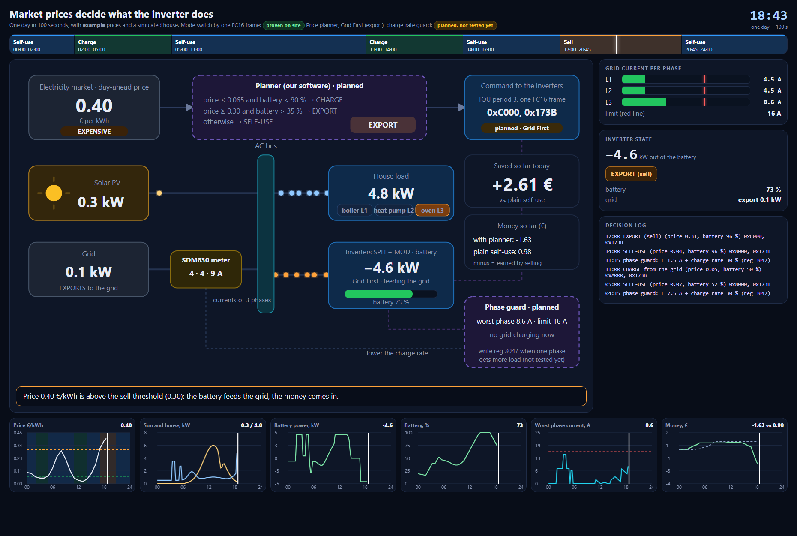

# growatt-sem-demo

### ▶ Open the live pages (rendered, with animation)

| | |
|---|---|
| **[All pages: start here](https://nailkarimov.github.io/growatt-sem-demo/)** | the index with four cards |
| [Architecture and data flow](https://nailkarimov.github.io/growatt-sem-demo/architecture.html) | coloured cards, animated arrows, six situations |
| [The control loop, 100 s](https://nailkarimov.github.io/growatt-sem-demo/control-loop.html) | sun and load change, the current limit, the charge rate is cut |
| [Market prices and the inverter](https://nailkarimov.github.io/growatt-sem-demo/market-prices.html) | one day: charge cheap, sell dear, phase guard |
| [How the work unfolded](https://nailkarimov.github.io/growatt-sem-demo/session-structure.html) | the route, the dead ends, the write that worked |

(Clicking the `.html` files in the file list of this repository shows their source code; GitHub does not run them. Use the links above.)

Interactive demo pages from the *Growatt SEM Monitor* project (reading a Growatt SEM-E site over RS485 / Modbus RTU
and switching the inverters' charge mode locally). The project itself is private; this repository holds only the
four self-contained pages, so that they can be shown by link.

| Page | What it shows | Based on |
|---|---|---|
| [`architecture.html`](https://nailkarimov.github.io/growatt-sem-demo/architecture.html) | The site, the bus, the shared code and the tools as coloured cards; six situations with animated data flows | the real site and code |
| [`control-loop.html`](https://nailkarimov.github.io/growatt-sem-demo/control-loop.html) | A 100-second loop: sun and house load change, one phase crosses the current limit, the controller lowers the charge rate | simulated inputs |
| [`market-prices.html`](https://nailkarimov.github.io/growatt-sem-demo/market-prices.html) | One day in 100 seconds: market prices decide charge / self-use / sell; a phase guard cuts the charge rate | example prices, simulated house |
| [`session-structure.html`](https://nailkarimov.github.io/growatt-sem-demo/session-structure.html) | The route of the work and why the first write attempts failed and one worked | the real experiments |

*Click the picture to open the live page.*

## Open them

* **Online:** https://nailkarimov.github.io/growatt-sem-demo/ (GitHub Pages, branch `main`, root).
* **Offline:** download the repository (Code -> Download ZIP) or a single `.html` file and open it in a browser. Every page is one
  self-contained file, nothing is loaded from the internet.
* **Move in time:** in `control-loop.html` and `market-prices.html` drag the mouse along the bar at the top (or on any chart) to go forward and back; the animation pauses while you drag. Arrow keys step by 1 s (Shift: 5 s). The time slider is in the control panel (hidden by `?clean`).
* **For a video:** add `?clean` to the address of `control-loop.html` or `market-prices.html` (hides the buttons), press F11 and record;
  Space pauses, R restarts.

## What is real and what is not

Only the mode switch (Load First <-> Battery First, one FC16 frame to the inverter's time-of-use period) has been tried on a real site.
Grid First (export), writing the charge rate, the price planner and the controller shown in the animations are plans, and the inputs
of the animations (sun, consumption, prices) are invented. File names such as `docs/experiments.md` mentioned inside the pages refer
to the private project.

## Third-party code

`architecture.html` embeds [LeaderLine](https://anseki.github.io/leader-line/) 1.0.8 (MIT licence, © anseki), which draws the arrows.
The licence notice stays in the file. The rest of the pages is plain HTML, CSS and JavaScript.

## Licence

No licence is granted for the pages beyond viewing and sharing the link or the files unchanged. Ask the author if you want to reuse them.
